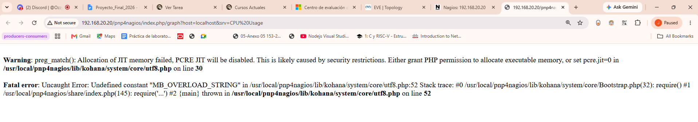
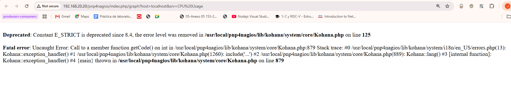
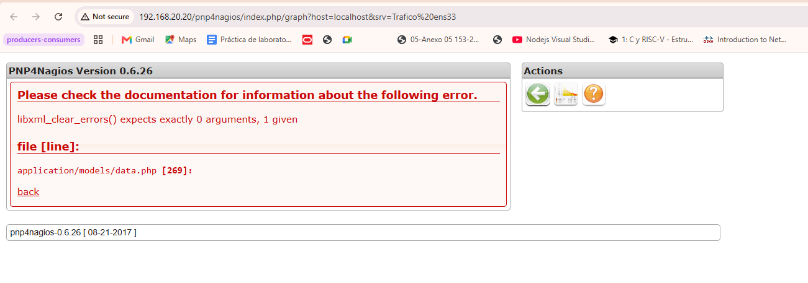
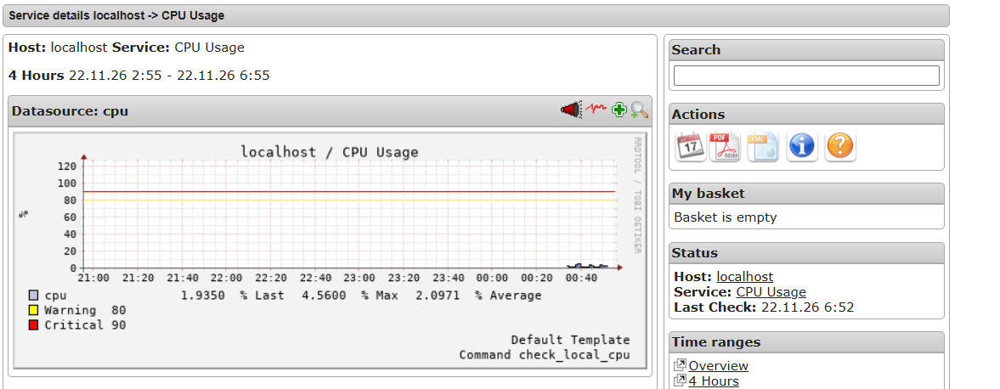

# Proyecto final NMS — Nagios Core

Guía de implementación del sistema de monitoreo: Nagios Core con SNMPv3, gráficas con PNP4Nagios, alertas por Telegram, bitácora syslog y scripts de comandos CLI. Cada sección termina con los **archivos importantes** que conviene mostrar en la demo.

## 0. Laboratorio

| Equipo | Rol | Red NAT (ens33) | Red LAN (ens37) |
|---|---|---|---|
| nms (NMS, `localhost`) | Nagios, PNP4Nagios, servidor syslog | `192.168.20.20` | `10.16.0.0/24` |
| server2 (`ubuntu-srv`) | Ubuntu Server monitoreado | `192.168.20.22` | `10.16.0.0/24` |
| R1 (`r-cisco`) | Router Cisco IOL 15.7 en EVE-NG | `192.168.20.24` (Ethernet0/0) | — |

| Dato | Valor |
|---|---|
| Usuario SNMPv3 | `final-project-nmm` |
| Seguridad SNMPv3 | `authPriv`: autenticación SHA + cifrado AES-128 |
| Bot de Telegram | `@NMM_project_bot` |

> **Red:** los tres equipos están en la red **NAT de VMware (VMnet8)**, incluida la primera NIC de la VM de EVE-NG (la que lleva la Management Cloud). El gateway de la red NAT es `192.168.20.2`.

Las claves SNMPv3 deben tener **al menos 8 caracteres**, solo letras, números, `-` y `_`, y ser distintas entre sí. En esta guía aparecen como `<clave_auth>` y `<clave_priv>`.

### Qué cubre cada requisito

| Requisito | Implementación | localhost | ubuntu-srv | r-cisco |
|---|---|:-:|:-:|:-:|
| NMS | Nagios Core 4.5.9 + PNP4Nagios | ✔ | | |
| Disco duro (%) | Utilizacion de Disco Duro | ✔ | ✔ | |
| Tráfico en interfaces | Trafico Interfaz `<nombre>` | ✔ | ✔ | ✔ |
| Memoria total y en uso | Memoria Total y En Uso | ✔ | ✔ | ✔ |
| Tráfico de paquetes ICMP | Trafico de Paquetes ICMP + Ping ICMP | ✔ | ✔ | ✔ |
| Usuarios en el sistema | Cantidad de Usuarios en el Sistema | ✔ | ✔ | |
| Notificaciones en pantalla | Umbrales OK / WARNING / CRITICAL | ✔ | ✔ | ✔ |
| Bitácora (syslog) | NMS como servidor syslog central | ✔ | ✔ | ✔ |
| Aviso al encargado | Bot de Telegram | ✔ | ✔ | ✔ |
| Comandos CLI | `monitoreo_cli.sh` y `monitoreo_router.sh` | ✔ | ✔ | ✔ |

---

## 1. Instalación de Nagios Core

```bash
# Dependencias
sudo apt update
sudo apt install -y autoconf gcc libc6 make wget unzip apache2 php libapache2-mod-php \
     libgd-dev openssl libssl-dev

# Descargar y compilar Nagios Core 4.5.9
V=4.5.9
cd /tmp && wget -O nagioscore.tar.gz \
  https://github.com/NagiosEnterprises/nagioscore/archive/nagios-$V.tar.gz
tar xzf nagioscore.tar.gz && cd nagioscore-nagios-$V
./configure --with-httpd-conf=/etc/apache2/sites-enabled
make all

# Instalar: usuario y grupo, binarios, servicio, configuración de ejemplo y sitio web
sudo make install-groups-users && sudo usermod -a -G nagios www-data
sudo make install install-daemoninit install-commandmode install-config install-webconf
sudo a2enmod rewrite cgi
sudo htpasswd -c /usr/local/nagios/etc/htpasswd.users nagiosadmin
sudo systemctl restart apache2 && sudo systemctl enable --now nagios
```

Plugins oficiales (`check_ping`, `check_disk`…) y herramientas SNMP:

```bash
sudo apt install -y libmcrypt-dev bc gawk dc build-essential snmp libnet-snmp-perl gettext
cd /tmp && wget https://github.com/nagios-plugins/nagios-plugins/releases/download/release-$P/nagios-plugins-$P.tar.gz
tar xzf nagios-plugins-$P.tar.gz && cd nagios-plugins-$P      # $P = versión descargada
./configure && make && sudo make install
```

La interfaz web queda en `http://192.168.20.20/nagios` (usuario `nagiosadmin`).

#### Archivos importantes

| Equipo | Archivo | Función |
|---|---|---|
| NMS | `/usr/local/nagios/etc/nagios.cfg` | Configuración principal de Nagios: qué archivos de objetos carga, registros y perfdata. |
| NMS | `/usr/local/nagios/etc/objects/` | Carpeta de objetos: hosts, servicios, comandos, contactos y plantillas. |
| NMS | `/usr/local/nagios/libexec/` | Carpeta de plugins: los programas que ejecutan los chequeos. |
| NMS | `/usr/local/nagios/var/nagios.log` | Registro de eventos de Nagios (el mismo que muestra *Event Log* en la web). |

---

## 2. Agentes SNMPv3

Todo el monitoreo se hace por **SNMPv3 `authPriv`**: cada consulta va autenticada (SHA) y cifrada (AES-128). No hay comunidades v1/v2c.

### 2.1 Servidores Ubuntu (NMS y server2)

```bash
sudo apt install -y snmpd snmp
sudo cp /etc/snmp/snmpd.conf /etc/snmp/snmpd.conf.bak
sudo nano /etc/snmp/snmpd.conf
```

Contenido de `/etc/snmp/snmpd.conf` en **server2**:

```ini
agentAddress  udp:161

# Usuario v3 de solo lectura; exige autenticación y cifrado (authPriv)
rouser        final-project-nmm  priv

sysLocation   Laboratorio NMS - VMware
sysContact    Encargado de monitoreo
sysServices   72

disk  /  10%

# Usuarios con sesión contados en systemd-logind
extend usuarios /usr/local/bin/usuarios_logind.sh
```

En el **NMS** es igual, salvo la primera línea, porque el agente solo atiende consultas locales:

```ini
agentAddress  udp:127.0.0.1:161
```

**Usuario SNMPv3.** Con snmpd detenido, se agrega esta línea al final de `/var/lib/snmp/snmpd.conf`:

```ini
createUser final-project-nmm SHA "<clave_auth>" AES "<clave_priv>"
```

```bash
sudo systemctl stop snmpd
sudo nano /var/lib/snmp/snmpd.conf        # agregar la línea createUser al final
sudo systemctl start snmpd && sudo systemctl enable snmpd
sudo ss -ulnp | grep 161
```

Al arrancar, snmpd convierte `createUser` en una entrada `usmUser` con las claves derivadas y borra la línea original: la clave no queda en texto plano.

### 2.2 Conteo de usuarios con systemd-logind

Ubuntu reciente ya no escribe `/run/utmp`, así que `who` y `hrSystemNumUsers` devuelven 0 aunque haya sesiones abiertas. Las sesiones se cuentan con `loginctl`, y el resultado se publica por SNMP con la línea `extend usuarios` de `snmpd.conf`.

Contenido de `/usr/local/bin/usuarios_logind.sh` (NMS y server2):

```bash
#!/bin/sh
# Cuenta las sesiones de clase "user" registradas en systemd-logind
n=0
for s in $(loginctl list-sessions --no-legend 2>/dev/null | awk '{print $1}'); do
  [ "$(loginctl show-session "$s" -p Class --value 2>/dev/null)" = "user" ] && n=$((n + 1))
done
echo "$n"
```

```bash
sudo chmod 755 /usr/local/bin/usuarios_logind.sh
/usr/local/bin/usuarios_logind.sh          # con tu sesión abierta: 1 o más
sudo systemctl restart snmpd
```

Solo cuenta la clase `user`: la sesión `manager` es interna de systemd y duplicaría el conteo.

### 2.3 Router Cisco R1

```text
configure terminal
 clock timezone CST -6 0
 service timestamps log datetime msec localtime show-timezone
!
ip access-list standard ACL-NMS
 permit host 192.168.20.20
 deny   any log
exit
snmp-server view VISTA-NMS iso included
snmp-server group GRUPO-NMS v3 priv read VISTA-NMS access ACL-NMS
snmp-server user final-project-nmm GRUPO-NMS v3 auth sha <clave_auth> priv aes 128 <clave_priv>
snmp-server location EVE-NG - Laboratorio NMS
snmp-server ifindex persist
end
write memory
```

Solo el NMS puede consultar (ACL). El usuario v3 no aparece en `show running-config`; se verifica con `show snmp user`.

### 2.4 Prueba desde el NMS

```bash
V3='-v3 -l authPriv -u final-project-nmm -a SHA -A <clave_auth> -x AES -X <clave_priv>'
snmpget  $V3 127.0.0.1     1.3.6.1.2.1.1.5.0     # NMS
snmpget  $V3 192.168.20.22 1.3.6.1.2.1.1.5.0     # server2
snmpget  $V3 192.168.20.24 1.3.6.1.2.1.1.5.0     # R1
snmpwalk $V3 192.168.20.24 1.3.6.1.2.1.2.2.1.2   # nombres de interfaces del router
snmpget  $V3 192.168.20.22 'NET-SNMP-EXTEND-MIB::nsExtendOutput1Line."usuarios"'
```

#### Archivos importantes

| Equipo | Archivo | Función |
|---|---|---|
| NMS y server2 | `/etc/snmp/snmpd.conf` | Configuración del agente SNMP: solo SNMPv3 con el usuario `final-project-nmm` en modo `priv`, y publicación del conteo de usuarios con `extend`. |
| NMS y server2 | `/var/lib/snmp/snmpd.conf` | Donde snmpd guarda el usuario v3 (`usmUser`) con las claves derivadas. |
| NMS y server2 | `/usr/local/bin/usuarios_logind.sh` | Cuenta las sesiones de usuario con `loginctl`, porque Ubuntu reciente ya no usa `/run/utmp`. |
| R1 | `show run \| section snmp` · `show snmp user` · `show access-lists ACL-NMS` | ACL que limita el acceso al NMS, vista, grupo v3 `priv` y usuario con SHA y AES-128. |

---

## 3. Plugin de monitoreo y objetos de Nagios

### 3.1 Plugin `check_snmp_nms.sh`

Plugin propio de Nagios (Bash). Consulta cada métrica por SNMPv3, la compara con los umbrales `-w`/`-c`, devuelve el código de salida (0 OK, 1 WARNING, 2 CRITICAL, 3 UNKNOWN) y entrega la **perfdata** (lo que va después del `|`) con la que se dibujan las gráficas.

| Modo | Métrica | Fuente SNMP | Equipos |
|---|---|---|---|
| `disk` | % de disco usado y MB | HOST-RESOURCES `hrStorage` | Linux |
| `mem` | Memoria total y en uso | UCD-SNMP `memTotalReal`, `memAvailReal`, búfer y caché | Linux |
| `mem-cisco` | Memoria total y en uso | CISCO-MEMORY-POOL | Router |
| `iface` | Tráfico RX/TX en bps y estado | IF-MIB `ifHCInOctets`, `ifHCOutOctets`, `ifOperStatus` | Todos |
| `icmp` | Paquetes ICMP in/out por segundo | IP-MIB `icmpInMsgs`, `icmpOutMsgs` | Todos |
| `users` | Sesiones de usuario | `extend usuarios` (respaldo: `hrSystemNumUsers`) | Linux |
| `uptime` | Minutos encendido (detecta reinicios) | `hrSystemUptime` (respaldo: `sysUpTime`) | Todos |

El tráfico y el ICMP son contadores acumulados: el plugin guarda la lectura anterior en `/usr/local/nagios/var/snmp-state/` y calcula `(valor actual − anterior) / segundos`.

```bash
sudo cp ~/proyecto-nms/plugins/check_snmp_nms.sh /usr/local/nagios/libexec/
sudo chown root:nagios /usr/local/nagios/libexec/check_snmp_nms.sh
sudo chmod 755 /usr/local/nagios/libexec/check_snmp_nms.sh

# Prueba como usuario nagios
P=/usr/local/nagios/libexec/check_snmp_nms.sh
CR='-u final-project-nmm -A <clave_auth> -X <clave_priv>'
sudo -u nagios $P -H 192.168.20.22 $CR -m disk -w 50 -c 70
sudo -u nagios $P -H 192.168.20.24 $CR -m mem-cisco
```

### 3.2 Credenciales y configuración principal

Contenido agregado al final de `/usr/local/nagios/etc/resource.cfg` (archivo protegido; las credenciales no se ven en la web):

```ini
$USER10$=final-project-nmm
$USER11$=<clave_auth>
$USER12$=<clave_priv>
```

Directivas de `/usr/local/nagios/etc/nagios.cfg` (se cambian las que ya existen, sin duplicarlas):

```ini
cfg_file=/usr/local/nagios/etc/objects/proyecto.cfg

use_syslog=1
log_notifications=1
log_service_retries=1
log_host_retries=1
```

### 3.3 Objetos del proyecto: `proyecto.cfg`

`/usr/local/nagios/etc/objects/proyecto.cfg` define todo el monitoreo del proyecto. Partes principales:

```nagios
# Comando que llama al plugin con las credenciales de resource.cfg
define command{
    command_name    check_snmp_nms
    command_line    $USER1$/check_snmp_nms.sh -H $HOSTADDRESS$ -u '$USER10$' -A '$USER11$' -X '$USER12$' $ARG1$
}

# Plantilla de los servicios SNMP: chequeo cada minuto e icono de gráfica
define service{
    name                    srv-snmp
    use                     generic-service
    check_interval          1
    retry_interval          1
    action_url              /pnp4nagios/index.php/graph?host=$HOSTNAME$&srv=$SERVICEDESC$
    register                0
}

# Host remoto: chequeo de vida cada minuto, DOWN confirmado en ~3 minutos
define host{
    use                     linux-server
    host_name               ubuntu-srv
    address                 192.168.20.22
    check_interval          1
    retry_interval          1
    max_check_attempts      3
}

# Grupos: los dos Linux reciben exactamente los mismos servicios
define hostgroup{
    hostgroup_name          linux-snmp
    members                 localhost,ubuntu-srv
}

# Ejemplo de servicio con sus umbrales
define service{
    use                     srv-snmp
    hostgroup_name          linux-snmp
    service_description     Utilizacion de Disco Duro
    check_command           check_snmp_nms!-m disk -p / -w 50 -c 70
}
```

| Servicio | localhost | ubuntu-srv | r-cisco |
|---|:-:|:-:|:-:|
| Utilizacion de Disco Duro | ✔ | ✔ | |
| Memoria Total y En Uso | ✔ | ✔ | ✔ |
| Cantidad de Usuarios en el Sistema | ✔ | ✔ | |
| Trafico de Paquetes ICMP | ✔ | ✔ | ✔ |
| Ping ICMP | ✔ | ✔ | ✔ |
| Trafico Interfaz ens33 / ens37 / Ethernet0_0 / Ethernet0_1 | ✔ | ✔ | ✔ |
| Tiempo Encendido | ✔ | ✔ | ✔ |

### 3.4 Mismos servicios en localhost y server2

Los servicios de ejemplo de `localhost.cfg` se desactivan con `quitar_servicios.py`, que comenta cada bloque con `#` y deja un respaldo:

```bash
cd ~/proyecto-nms/nagios
F=/usr/local/nagios/etc/objects/localhost.cfg
S=("Current Load" "Current Users" "Root Partition" "Memoria RAM" "Trafico de interfaz" \
   "CPU Usage" "HTTP" "SSH" "Total Processes" "PING")
sudo python3 quitar_servicios.py "$F" localhost "${S[@]}"             # vista previa
sudo python3 quitar_servicios.py --aplicar "$F" localhost "${S[@]}"   # aplica
```

### 3.5 Umbrales: notificaciones en pantalla

Nagios pinta cada servicio según el código de salida del plugin: **verde** (OK), **amarillo** (WARNING), **rojo** (CRITICAL), **naranja** (UNKNOWN). Los umbrales son los valores de `-w` y `-c` en la línea `check_command` de cada servicio de `proyecto.cfg`.

| Servicio | Métrica | WARNING | CRITICAL |
|---|---|---|---|
| Utilizacion de Disco Duro | % usado | ≥ 50 % | ≥ 70 % |
| Memoria Total y En Uso | % en uso | ≥ 50 % | ≥ 70 % |
| Cantidad de Usuarios en el Sistema | sesiones | ≥ 3 | ≥ 4 |
| Trafico Interfaz | Mbps (mayor entre RX y TX) | ≥ 5 | ≥ 10 o interfaz DOWN |
| Trafico de Paquetes ICMP | pkt/s (mayor entre in y out) | ≥ 3 | ≥ 10 |
| Ping ICMP | RTA / pérdida | 100 ms o 20 % | 500 ms o 60 % |
| Tiempo Encendido | minutos desde el arranque | < 10 | — |
| Host | responde a ping | — | DOWN |

Nagios confirma cada problema en 3 chequeos (estado **HARD**) antes de notificar. En la web se ve en *Tactical Overview*, *Services* y *Problems → Services (Unhandled)*.

```bash
sudo /usr/local/nagios/bin/nagios -v /usr/local/nagios/etc/nagios.cfg && sudo systemctl restart nagios
```

#### Archivos importantes

| Equipo | Archivo | Función |
|---|---|---|
| NMS | `/usr/local/nagios/libexec/check_snmp_nms.sh` | Plugin propio: obtiene cada métrica por SNMPv3, decide OK/WARNING/CRITICAL y entrega la perfdata de las gráficas. |
| NMS | `/usr/local/nagios/etc/objects/proyecto.cfg` | Define hosts, grupos, comando, plantilla `srv-snmp`, servicios con sus umbrales y el contacto de Telegram. |
| NMS | `/usr/local/nagios/etc/resource.cfg` | Guarda el usuario y las claves SNMPv3 en `$USER10$`–`$USER12$`. |
| NMS | `/usr/local/nagios/etc/nagios.cfg` | Carga `proyecto.cfg` y envía los eventos de Nagios a syslog. |
| NMS | `/usr/local/nagios/etc/objects/localhost.cfg` | Servicios de ejemplo de localhost, comentados para igualar los servicios con server2. |
| NMS | `/usr/local/nagios/var/snmp-state/` | Última lectura de cada contador, para calcular el tráfico y el ICMP por segundo. |

---

## 4. Gráficas con PNP4Nagios

Nagios Core no grafica por sí solo. PNP4Nagios toma la perfdata de los plugins y genera las gráficas con RRDtool.

```bash
sudo apt install -y rrdtool librrds-perl php-gd php-xml php-mbstring git build-essential
cd /tmp && git clone https://github.com/lingej/pnp4nagios.git && cd pnp4nagios
./configure --with-httpd-conf=/etc/apache2/sites-enabled \
            --with-nagios-user=nagios --with-nagios-group=nagios
make all && sudo make fullinstall
sudo a2enmod rewrite && sudo systemctl restart apache2
```

### 4.1 NPCD con una unidad nativa de systemd

NPCD es el demonio que toma la perfdata que deja Nagios y la guarda en los archivos RRD. Contenido de `/etc/systemd/system/npcd.service`:

```ini
[Unit]
Description=PNP4Nagios Perfdata C Daemon (NPCD)
After=network.target nagios.service

[Service]
Type=simple
ExecStart=/usr/local/pnp4nagios/bin/npcd -f /usr/local/pnp4nagios/etc/npcd.cfg
Restart=on-failure

[Install]
WantedBy=multi-user.target
```

```bash
sudo /usr/lib/systemd/systemd-sysv-install disable npcd
sudo mv /etc/init.d/npcd /root/npcd.init.bak      # script SysV que dejó make fullinstall
sudo systemctl daemon-reload
sudo systemctl enable --now npcd
```

### 4.2 Perfdata en Nagios

Directivas de `/usr/local/nagios/etc/nagios.cfg` (modo *bulk*; las de host son equivalentes con `host_`):

```ini
process_performance_data=1
service_perfdata_file=/usr/local/pnp4nagios/var/service-perfdata
service_perfdata_file_template=DATATYPE::SERVICEPERFDATA\tTIMET::$TIMET$\tHOSTNAME::$HOSTNAME$\tSERVICEDESC::$SERVICEDESC$\tSERVICEPERFDATA::$SERVICEPERFDATA$\tSERVICECHECKCOMMAND::$SERVICECHECKCOMMAND$\tHOSTSTATE::$HOSTSTATE$\tHOSTSTATETYPE::$HOSTSTATETYPE$\tSERVICESTATE::$SERVICESTATE$\tSERVICESTATETYPE::$SERVICESTATETYPE$
service_perfdata_file_mode=a
service_perfdata_file_processing_interval=15
service_perfdata_file_processing_command=process-service-perfdata-file
```

Comando que entrega el archivo a NPCD (en `proyecto.cfg`):

```nagios
define command{
    command_name    process-service-perfdata-file
    command_line    /bin/mv /usr/local/pnp4nagios/var/service-perfdata /usr/local/pnp4nagios/var/spool/service-perfdata.$TIMET$
}
```

Icono de gráfica en todos los servicios y hosts: dentro de `generic-service` y `generic-host` en `/usr/local/nagios/etc/objects/templates.cfg`:

```nagios
action_url      /pnp4nagios/index.php/graph?host=$HOSTNAME$&srv=$SERVICEDESC$     # generic-service
action_url      /pnp4nagios/index.php/graph?host=$HOSTNAME$&srv=_HOST_            # generic-host
```

### 4.3 Compatibilidad con PHP 8.4

PNP4Nagios 0.6.26 y su framework (Kohana) son anteriores a PHP 8. Con PHP 8.4 aparecieron estos errores en la página de gráficas, uno tras otro:

| Error | Causa | Corrección |
|---|---|---|
| `Undefined constant "MB_OVERLOAD_STRING"` | Constante eliminada en PHP 8 (`utf8.php`) | Reemplazar la comprobación por `0` |
| `E_STRICT is deprecated` / `getCode() on int` | Kohana recibe los avisos de PHP 8.4 como números (`Kohana.php`) | `E_STRICT` → `2048` y que el manejador ignore deprecated, notice y warning |
| `libxml_clear_errors() expects exactly 0 arguments` | La función ya no acepta argumentos (`data.php`) | Quitar el argumento |
| `sizeof(): Argument #1 must be of type Countable` | `sizeof()` estricto en PHP 8 (`data.php`) | Validar con `is_array()` |
| `Allocation of JIT memory failed` | Restricción de memoria ejecutable | `pcre.jit=0` |
| Horas desfasadas 6 horas | PHP en UTC | `date.timezone = America/Guatemala` |

**Error 1.** `MB_OVERLOAD_STRING` (`utf8.php`):



**Error 2.** `E_STRICT` obsoleto y `getCode()` sobre un entero (`Kohana.php`):



**Error 3.** `libxml_clear_errors()` con un argumento (`data.php`). Este ya lo muestra la página de error de PNP4Nagios: Kohana y PHP ya funcionan.



Correcciones en el código de PNP4Nagios:

```bash
P=/usr/local/pnp4nagios; K=$P/lib/kohana/system/core
sudo cp $K/utf8.php $K/utf8.php.bak; sudo cp $K/Kohana.php $K/Kohana.php.bak

# 1. MB_OVERLOAD_STRING
sudo sed -i -E "s/ini_get\('mbstring\.func_overload'\) *& *MB_OVERLOAD_STRING/0/" $K/utf8.php

# 2. E_STRICT y manejador de errores de Kohana
sudo grep -rl 'E_STRICT' $P/lib $P/share | xargs sudo sed -i 's/\bE_STRICT\b/2048/g'
sudo sed -i '/public static function exception_handler(/{n;s/{/{ if (is_int($exception) \&\& in_array($exception, array(E_DEPRECATED, E_USER_DEPRECATED, E_NOTICE, E_USER_NOTICE, E_WARNING, E_USER_WARNING, 2048))) return TRUE;/}' $K/Kohana.php

# 3. libxml_clear_errors()
sudo grep -rl 'libxml_clear_errors(' $P/share/application | \
  xargs sudo sed -i 's/libxml_clear_errors([^)]\+)/libxml_clear_errors()/g'

# 4. sizeof()
sudo sed -i 's/if(sizeof(\$pages) > 0 ){/if(is_array($pages) \&\& sizeof($pages) > 0 ){/' \
     $P/share/application/models/data.php
```

Ajustes de PHP solo para Apache. Contenido de `/etc/php/8.4/apache2/conf.d/99-pnp4nagios.ini`:

```ini
pcre.jit=0
error_reporting = E_ALL & ~E_DEPRECATED & ~E_NOTICE
display_errors = Off
date.timezone = America/Guatemala
```

```bash
sudo systemctl restart apache2
sudo rm /usr/local/pnp4nagios/share/install.php     # cuando la verificación de entorno sale en verde
```

**Resultado:** la página de gráficas carga y dibuja los datos con sus líneas de warning y critical.



### 4.4 Plantilla propia de gráficas

PNP4Nagios elige la plantilla por el nombre del comando. `check_snmp_nms.php` agrupa los datos relacionados: memoria total y en uso en la misma gráfica (MB) y el % aparte; entrada y salida de cada interfaz juntas; ICMP entrante y saliente; y las líneas de umbral en todas.

```bash
sudo cp ~/proyecto-nms/pnp4nagios/check_snmp_nms.php /usr/local/pnp4nagios/share/templates/
```

#### Archivos importantes

| Equipo | Archivo | Función |
|---|---|---|
| NMS | `/usr/local/pnp4nagios/share/templates/check_snmp_nms.php` | Plantilla propia: decide cómo se dibuja la perfdata del plugin (memoria total y en uso juntas, RX/TX juntos, umbrales). |
| NMS | `/etc/php/8.4/apache2/conf.d/99-pnp4nagios.ini` | Ajustes de PHP para que PNP4Nagios funcione con PHP 8.4. |
| NMS | `/etc/systemd/system/npcd.service` | Servicio de NPCD, que convierte la perfdata en archivos RRD. |
| NMS | `/usr/local/nagios/etc/nagios.cfg` (directivas `*_perfdata_*`) | Hace que Nagios escriba la perfdata para PNP4Nagios. |
| NMS | `/usr/local/pnp4nagios/var/perfdata/` | Base de datos de las gráficas: una carpeta por host con un `.rrd` por servicio. |

---

## 5. Bot de Telegram y notificaciones

1. En Telegram, abre **@BotFather** → `/newbot` → nombre y usuario del bot. Guarda el **token**.
2. Abre el bot y presiona **Start** (o envíale un mensaje).
3. Obtén tu **chat_id** (el de tu cuenta, no el número del bot que aparece en el token):

```bash
curl -s "https://api.telegram.org/bot<token>/getUpdates" | grep -o '"chat":{"id":-\?[0-9]*'
```

4. Guarda el token en `/usr/local/nagios/etc/telegram.conf`, con este contenido:

```ini
TELEGRAM_TOKEN="<token completo de BotFather>"
```

```bash
sudo chown root:nagios /usr/local/nagios/etc/telegram.conf
sudo chmod 640 /usr/local/nagios/etc/telegram.conf
sudo cp ~/proyecto-nms/plugins/notify_telegram.sh /usr/local/nagios/libexec/
sudo chmod 755 /usr/local/nagios/libexec/notify_telegram.sh
```

5. Contacto y comandos de notificación (en `proyecto.cfg`). El chat_id va en el campo `pager`:

```nagios
define contact{
    contact_name                    encargado-telegram
    pager                           <chat_id>
    service_notification_options    w,u,c,r,f
    host_notification_options       d,u,r,f
    service_notification_commands   notify-service-by-telegram
    host_notification_commands      notify-host-by-telegram
}

define command{
    command_name    notify-service-by-telegram
    command_line    $USER1$/notify_telegram.sh service "$CONTACTPAGER$" "$NOTIFICATIONTYPE$" "$HOSTNAME$" "$HOSTADDRESS$" "$SERVICEDESC$" "$SERVICESTATE$" "$SERVICEOUTPUT$" "$LONGDATETIME$"
}
```

6. En `/usr/local/nagios/etc/objects/contacts.cfg`, el contacto se agrega al grupo `admins`, que es el grupo al que notifican los servicios:

```nagios
define contactgroup{
    contactgroup_name       admins
    alias                   Nagios Administrators
    members                 nagiosadmin,encargado-telegram
}
```

7. Prueba manual del envío:

```bash
sudo -u nagios /usr/local/nagios/libexec/notify_telegram.sh service <chat_id> PROBLEM \
     ubuntu-srv 192.168.20.22 "Prueba" CRITICAL "Mensaje de prueba desde Nagios" "$(date)"
```

Flujo de una alerta: umbral superado → SOFT → HARD (3 chequeos) → grupo `admins` → `encargado-telegram` → `notify_telegram.sh` → Telegram. Cada envío o error queda en syslog con la etiqueta `nagios-telegram`.

#### Archivos importantes

| Equipo | Archivo | Función |
|---|---|---|
| NMS | `/usr/local/nagios/libexec/notify_telegram.sh` | Recibe de Nagios los datos de la alerta, arma el mensaje con su emoji de estado y lo envía a la API de Telegram con `curl`. |
| NMS | `/usr/local/nagios/etc/objects/proyecto.cfg` (contacto y comandos) | El contacto `encargado-telegram` con el chat_id y los comandos que llaman al script. |
| NMS | `/usr/local/nagios/etc/objects/contacts.cfg` | Incluye `encargado-telegram` en el grupo `admins`. |
| NMS | `/usr/local/nagios/etc/telegram.conf` | Token del bot. Mostrar solo los permisos (`ls -l`: `root:nagios 640`), **nunca el contenido**. |

---

## 6. Bitácora de eventos (syslog)

El **NMS es el servidor syslog central**: escucha en UDP/514 y guarda un archivo por equipo. server2 y R1 le envían sus eventos. Los eventos de Nagios y de Telegram van además a un archivo propio.

### 6.1 Servidor: NMS

Contenido de `/etc/rsyslog.d/10-remoto.conf`:

```ini
module(load="imudp")
input(type="imudp" port="514" ruleset="remoto")

template(name="ArchivoRemoto" type="string" string="/var/log/remoto/%FROMHOST-IP%.log")

ruleset(name="remoto") {
    action(type="omfile" dynaFile="ArchivoRemoto")
    stop
}
```

Contenido de `/etc/rsyslog.d/30-nagios.conf`:

```ini
if ($programname startswith "nagios") then {
    action(type="omfile" file="/var/log/nagios-eventos.log")
}
```

```bash
sudo mkdir -p /var/log/remoto && sudo chown syslog:adm /var/log/remoto
sudo rsyslogd -N1                      # valida la sintaxis
sudo systemctl restart rsyslog
sudo ss -ulnp | grep 514
```

### 6.2 Cliente: server2

Contenido de `/etc/rsyslog.d/90-reenvio.conf` (la cola guarda los eventos si el NMS no responde):

```ini
*.* action(type="omfwd" target="192.168.20.20" port="514" protocol="udp"
           queue.type="LinkedList" queue.size="10000" action.resumeRetryCount="-1")
```

```bash
sudo rsyslogd -N1 && sudo systemctl restart rsyslog
logger -p user.warning "Prueba de syslog desde server2"
```

### 6.3 Cliente: router R1

```text
configure terminal
 service timestamps log datetime msec localtime show-timezone
 logging host 192.168.20.20
 logging trap informational
 logging origin-id hostname
end
write memory
```

### 6.4 Verificación

```bash
sudo tail -f /var/log/remoto/192.168.20.22.log    # server2
sudo tail -f /var/log/remoto/192.168.20.24.log    # R1: entrar y salir de configure terminal genera %SYS-5-CONFIG_I
sudo tail -f /var/log/nagios-eventos.log          # alertas, notificaciones y envíos a Telegram
```

#### Archivos importantes

| Equipo | Archivo | Función |
|---|---|---|
| NMS | `/etc/rsyslog.d/10-remoto.conf` | Convierte al NMS en servidor syslog: recibe en UDP/514 y separa los eventos por IP de origen. |
| NMS | `/etc/rsyslog.d/30-nagios.conf` | Copia los eventos de Nagios y del script de Telegram a su propio archivo. |
| server2 | `/etc/rsyslog.d/90-reenvio.conf` | Reenvía todos los eventos de server2 al NMS. |
| R1 | `show logging` | Destino (`192.168.20.20`) y nivel (`informational`) del syslog del router. |
| NMS | `/var/log/remoto/192.168.20.22.log` · `/var/log/remoto/192.168.20.24.log` | Bitácora de server2 y de R1. |
| NMS | `/var/log/nagios-eventos.log` | Bitácora del sistema de monitoreo. |

---

## 7. Pruebas de umbrales y notificaciones

Cada carga debe durar **al menos 4 minutos**, para que el estado llegue a HARD y se envíe la notificación. Al quitarla llega el RECOVERY.

### 7.1 Disco y memoria (en server2)

| Prueba | Comando | Rollback |
|---|---|---|
| Disco WARNING (~52 %) | `fallocate -l 3500M /var/tmp/relleno` | `rm /var/tmp/relleno` |
| Disco CRITICAL (~73 %) | `fallocate -l 6500M /var/tmp/relleno` | `rm /var/tmp/relleno` |
| Memoria WARNING (~63 %) | `stress-ng --vm 1 --vm-bytes 3G --vm-keep -t 300s` | Termina sola (o `Ctrl+C`) |
| Memoria CRITICAL (~82 %) | `stress-ng --vm 1 --vm-bytes 4G --vm-keep -t 300s` | Termina sola (o `Ctrl+C`) |
| Usuarios WARNING / CRITICAL | Abrir 3 / 4 sesiones (consola + SSH) | `exit` en las sesiones |

En el NMS: `2500M` / `5500M` para disco y `1G` / `1600M` para memoria. `stress-ng` se instala con `sudo apt install -y stress-ng`.

### 7.2 ICMP, tráfico y latencia

| Prueba | Comando | Rollback |
|---|---|---|
| ICMP WARNING (~5 pkt/s) | `ping -i 0.2 -c 1200 192.168.20.22` | Termina solo |
| ICMP CRITICAL (~20 pkt/s) | `sudo ping -i 0.05 -c 5000 192.168.20.22` | Termina solo |
| Tráfico WARNING (7 Mbps) | `iperf3 -c 10.16.0.22 -b 7M -t 240` | Termina solo |
| Tráfico CRITICAL (20 Mbps) | `iperf3 -c 10.16.0.22 -b 20M -t 240` | Termina solo |
| Latencia WARNING (en server2) | `sudo tc qdisc replace dev ens33 root netem delay 150ms` | `sudo tc qdisc del dev ens33 root` |
| Latencia CRITICAL (en server2) | `sudo tc qdisc replace dev ens33 root netem delay 600ms` | `sudo tc qdisc del dev ens33 root` |
| Pérdida WARNING (en server2) | `sudo tc qdisc replace dev ens33 root netem loss 30%` | `sudo tc qdisc del dev ens33 root` |

`iperf3` usa el daemon que ya escucha en server2 (puerto 5201); el tráfico por la LAN se ve en `Trafico Interfaz ens37`. `tc netem` se aplica **siempre en server2, nunca en el NMS** (afectaría los chequeos y los envíos a Telegram). Verifica con `tc qdisc show dev ens33`.

### 7.3 Interfaces, reinicios y caídas

| Prueba | Comando | Rollback | Aviso en Telegram |
|---|---|---|---|
| Interfaz DOWN | R1: `interface Ethernet0/1` → `shutdown` | `no shutdown` | CRITICAL / RECOVERY |
| Reinicio rápido | `sudo reboot` (server2) · `reload` (R1) | — | WARNING de Tiempo Encendido |
| Host DOWN | `sudo poweroff` · detener el nodo en EVE-NG | Encender | DOWN / RECOVERY |
| Agente SNMP caído | `sudo systemctl stop snmpd` | `sudo systemctl start snmpd` | UNKNOWN / RECOVERY |

Para la interfaz se usa `Ethernet0/1`: si se apaga `Ethernet0/0`, el router deja de responder y llega el DOWN del host en lugar del CRITICAL de la interfaz.

---

## 8. Scripts de comandos CLI

### 8.1 Acceso SSH con llave pública desde el NMS

**NMS → server2** (ed25519, con tu usuario y sin `sudo`):

```bash
ssh-keygen -t ed25519 -f ~/.ssh/id_ed25519_srv2 -N "" -C "nms-monitoreo"
ssh-copy-id -i ~/.ssh/id_ed25519_srv2.pub <usuario>@192.168.20.22
```

**NMS → R1** (RSA: IOS 15.7 no acepta ed25519):

```bash
ssh-keygen -t rsa -b 2048 -f ~/.ssh/id_rsa_r1 -N "" -C "nms-monitoreo"
cut -d' ' -f2 ~/.ssh/id_rsa_r1.pub | fold -w 72     # líneas para pegar en key-string
```

Configuración SSH del router (la consola de EVE-NG sigue sin login: AAA se aplica solo a las líneas VTY):

```text
configure terminal
 ip domain name nmm.lab
 crypto key generate rsa general-keys modulus 2048
 ip ssh version 2
 ip ssh logging events
 username monitoreo privilege 15 secret <clave_respaldo>
 aaa new-model
 aaa authentication login VTY-LOCAL local
 aaa authorization exec VTY-LOCAL local
 aaa authentication login CONSOLA none
 line con 0
  login authentication CONSOLA
 line vty 0 4
  login authentication VTY-LOCAL
  authorization exec VTY-LOCAL
  transport input ssh
  access-class ACL-NMS in
 ip ssh pubkey-chain
  username monitoreo
   key-string
    <líneas de fold>
   exit
end
write memory
```

Contenido de `~/.ssh/config` en el NMS (OpenSSH 10 trae desactivados los algoritmos antiguos de IOS 15.7; se habilitan **solo para R1**):

```text
Host server2
    HostName 192.168.20.22
    User <usuario>
    IdentityFile ~/.ssh/id_ed25519_srv2
    IdentitiesOnly yes

Host r1
    HostName 192.168.20.24
    User monitoreo
    IdentityFile ~/.ssh/id_rsa_r1
    IdentitiesOnly yes
    KexAlgorithms +diffie-hellman-group14-sha1
    HostKeyAlgorithms +ssh-rsa
    PubkeyAcceptedAlgorithms +ssh-rsa
```

```bash
chmod 700 ~/.ssh && chmod 600 ~/.ssh/config
ssh -q server2 hostname          # server2, sin pedir contraseña
ssh -q r1 "show clock"           # hora del router con CST
```

### 8.2 Uso de los scripts

Los dos se ejecutan desde el NMS, en `~/proyecto-nms/cli`. Requisitos en NMS y server2: `sudo apt install -y speedtest-cli sysstat iperf3`.

```bash
cd ~/proyecto-nms/cli
./monitoreo_cli.sh ens33 10                      # NMS (local)
./monitoreo_cli.sh --remoto server2 ens33 10     # server2 (remoto por SSH)
./monitoreo_router.sh r1 Ethernet0/0             # R1 (remoto por SSH, comandos IOS)
ls -l reporte_cli_*
```

| Script | Argumentos (en orden) | Por defecto |
|---|---|---|
| `monitoreo_cli.sh` | `[--remoto <alias>] [interfaz] [segundos] [destino]` | local · `ens33` · `5` · `192.168.20.24` |
| `monitoreo_router.sh` | `[alias] [interfaz] [destino]` | `r1` · `Ethernet0/0` · `192.168.20.20` |

Los argumentos son posicionales: para indicar el tercero hay que escribir también los anteriores. `--remoto` siempre va primero; con él, el NMS copia el script a server2, lo ejecuta allá y guarda el reporte en el NMS sin dejar archivos en el remoto.

### 8.3 Comandos de cada script

| Punto | Linux (`monitoreo_cli.sh`) | Router (`monitoreo_router.sh`) |
|---|---|---|
| Velocidad del ancho de banda | `speedtest-cli --simple` | `show interfaces Ethernet0/0 \| include BW\|duplex` |
| Usuarios conectados | `loginctl list-sessions` · `usuarios_logind.sh` | `show users` |
| Throughput de una interfaz | Contadores de `/sys/class/net/<if>/statistics` · `ip -s link` · `sar -n DEV` | `show interfaces Ethernet0/0 \| include rate` |
| Capacidad de disco | `df -hT` · `df -i` | `show file systems` · `dir nvram:` (IOL no tiene flash) |
| Memoria | `free -h` | `show memory statistics` |
| Procesos | `ps aux --sort=-%cpu` · `--sort=-%mem` | `show processes cpu sorted` · `show processes memory sorted` |
| Puertos en escucha | `ss -tuln` | `show control-plane host open-ports` |
| Rutas | `ip route` | `show ip route` |
| Hora | `timedatectl` | `show clock detail` |
| Tiempo encendido | `uptime` | `show version \| include uptime` |
| Conectividad | `ping -c 4 <destino>` | `ping 192.168.20.20` |

El ancho de banda real entre los dos servidores se mide con `iperf3 -c 10.16.0.22 -t 10` desde el NMS.

#### Archivos importantes

| Equipo | Archivo | Función |
|---|---|---|
| NMS | `~/proyecto-nms/cli/monitoreo_cli.sh` | Ejecuta en un servidor Linux los comandos de monitoreo y guarda un reporte. Con `--remoto server2` lo ejecuta en server2 por SSH. |
| NMS | `~/proyecto-nms/cli/monitoreo_router.sh` | Ejecuta los comandos equivalentes de IOS en R1 por SSH con llave. |
| NMS | `~/.ssh/config` | Alias `server2` y `r1` con sus llaves; algoritmos antiguos habilitados solo para R1. |
| server2 | `~/.ssh/authorized_keys` | Llave pública del NMS que permite entrar sin contraseña. |
| R1 | `show run \| section pubkey-chain` · `show ip ssh` | Llave pública del NMS cargada en el router y estado de SSHv2. |
| NMS | `reporte_cli_<equipo>_<fecha>.txt` | Los reportes generados, uno por equipo. |

---

## 9. Lista de verificación para la demo

- [ ] Los tres hosts y todos los servicios en verde (*Services*)
- [ ] Gráficas de disco, memoria total y en uso, interfaces, ICMP y usuarios
- [ ] Servicios en WARNING y CRITICAL en la GUI (sección 7)
- [ ] Mensajes en Telegram: PROBLEM, RECOVERY e interfaz DOWN
- [ ] `/var/log/remoto/*.log` y `/var/log/nagios-eventos.log` con eventos
- [ ] Los tres reportes `reporte_cli_*`

**Antes de grabar:** no muestres el contenido de `telegram.conf`, las claves de `resource.cfg` o del `createUser`, las llaves privadas (`~/.ssh/id_*` sin `.pub`) ni el chat_id completo. Si un archivo las incluye, muéstralo filtrado (`grep -v`) o tápalas en la edición. Antes de la demo, verifica la salida a Internet del NMS (`ping -c 3 8.8.8.8`) y que el servicio *VMware NAT Service* de Windows esté activo.

---

## 10. Solución de problemas

| Síntoma | Causa probable |
|---|---|
| Servicios SNMP en `UNKNOWN` con salida vacía | Credenciales v3 distintas a las de `resource.cfg`: prueba el `snmpget` de la sección 2.4 |
| `Authentication failure` / `Decryption error` | Clave de autenticación o de cifrado distinta entre el NMS y el agente |
| `Timeout` al consultar el router | Conectividad, ACL `ACL-NMS` o EVE-NG fuera de la red NAT |
| `UNKNOWN - Interfaz ... no encontrada` | Nombre distinto: revísalo con `snmpwalk ... 1.3.6.1.2.1.2.2.1.2` (distingue mayúsculas) |
| Usuarios en 0 con sesiones abiertas | Falta `usuarios_logind.sh` o la línea `extend usuarios` en `snmpd.conf` |
| El servicio no muestra icono de gráfica | Falta `action_url` o la perfdata aún no se procesó |
| PNP4Nagios: "perfdata directory is empty" | `process_performance_data=1`, NPCD activo y `/usr/local/pnp4nagios/var/perfdata/` |
| No llega Telegram | `sudo grep nagios-telegram /var/log/syslog`: `Resolving timed out` = el NMS sin Internet (revisar *VMware NAT Service*) |
| No llega syslog remoto | `sudo tcpdump -ni ens33 udp port 514` en el NMS |
| `ssh r1` falla con `no matching key exchange method` | El bloque `Host r1` no se lee: `~/.ssh` debe pertenecer a tu usuario, no a root |
